<p align="center">
  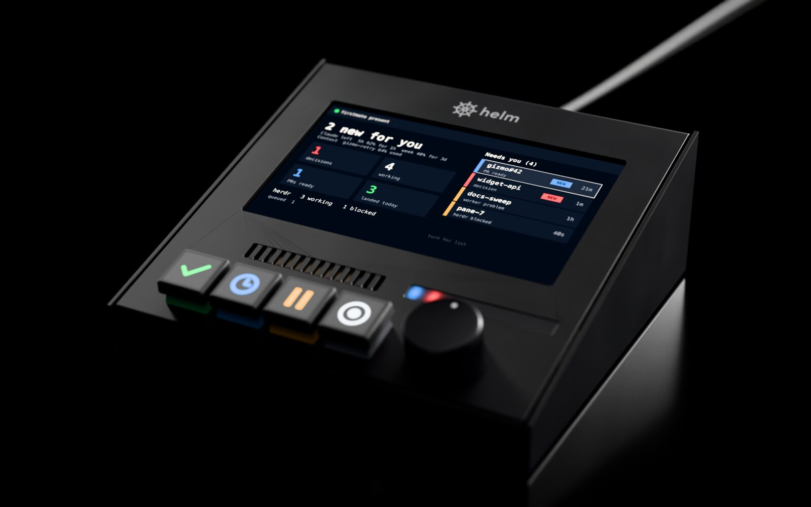
</p>

<h1 align="center">Helm</h1>

<p align="center"><strong>Your agents, one glance away.</strong></p>

<p align="center">
Helm is a desk control deck for <a href="#what-you-need">firstmate and herdr</a>. A 5 inch screen and eight lights tell you what needs you. Four held keys answer it. Your keyboard stays on your work.
</p>

<p align="center">
  <a href="#build-your-own">Build your own</a> ·
  <a href="#try-the-simulator">Try the simulator</a> ·
  <a href="#how-it-works">How it works</a> ·
  <a href="#project-status">Status</a>
</p>

> **Status:** designed, simulated, and the firmware builds in CI. It has not yet run on a real board, and the product images and video are renders. Details under [Project status](#project-status).

<p align="center">
  <a href="docs/media/helm-teaser.mp4">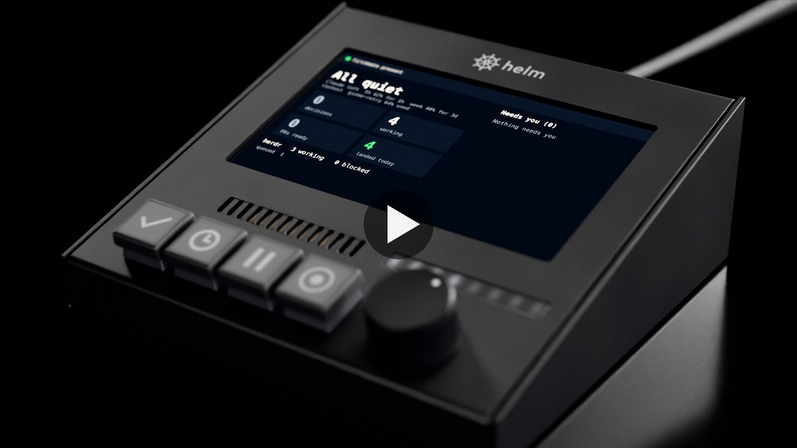</a>
  <br>
  <sub>The 35 second teaser (with sound). Click to play.</sub>
</p>

<video src="docs/media/helm-teaser.mp4" poster="docs/images/teaser-poster.jpg" controls width="880"></video>

## Why Helm

Running a crew of AI agents means a steady trickle of small asks. Merge this PR? Which of these two options? This worker is stuck. Each one is quick to answer and expensive to notice: find the right window, scroll the right pane, remember what the question was, then find your place again.

Helm moves those asks out of your windows and onto your desk. When nothing needs you, it stays calm and shows how much Claude usage you have left. When something new arrives, a light in its color starts to pulse and a single chime sounds. You glance down, read it, and answer with one held key. Your editor never loses focus.

It is not another dashboard. It shows what is new since you last touched it, so a long backlog never turns into a wall of red. And it never acts on its own: every press is a note to firstmate, which acts through the same guards it always uses.

## The controls

<p align="center">
  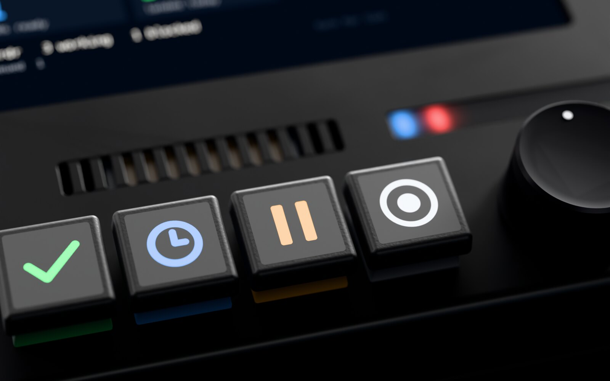
</p>

| Control | Action | What it does |
| --- | --- | --- |
| **YES** (green check) | hold 1 s | "Go." On a PR waiting to merge, firstmate merges that exact PR under its normal checks. On a decision, it goes with its recommendation, only if it gave exactly one. If neither fits, it changes nothing and replies. YES stays dark when the PR is known red or conflicted. |
| **LATER** (blue clock) | hold 1 s | "Not now." Asks firstmate to defer the item until tomorrow. |
| **HOLD** (amber pause) | hold 1 s | "Stop, and talk to me." Tells firstmate not to proceed and to raise it with you in chat. The one answer key that also works on a stuck worker. |
| **SHOW ME** (white ring) | tap | "Let me see." Brings the item's herdr pane to the front (the worker's own pane, or firstmate's pane for a decision), then opens the item in your browser: its live Lavish review board, else its report as a styled page, else its PR. Lit only when the item has a herdr pane. |
| **Knob** | turn | On Home, step through your project views (all, then each project). In the list, move between items. |
| | press | Open the selected item's full text, go back, or dismiss a result. |
| | press and hold | Mute the chime. The knob glows red while muted; hold again to unmute. |

A key is lit only when its action applies to the selected item. While you hold an answer key, the screen shows the exact item and action with a one second fill bar; let go early and nothing is sent.

<table>
  <tr>
    <td width="50%">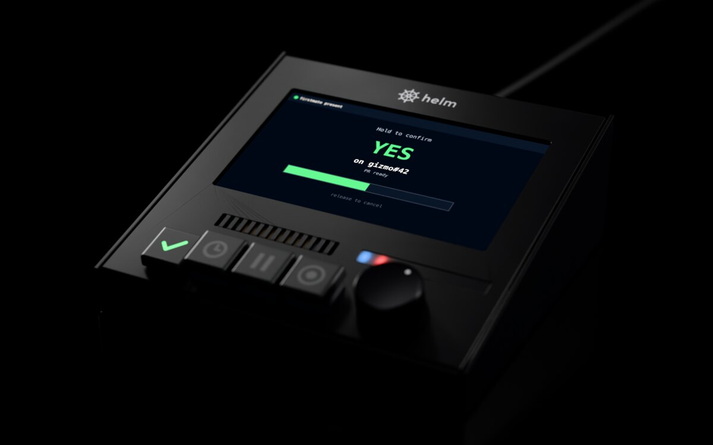<br><strong>Hold YES.</strong> The exact item and action, and a one second fill bar.</td>
    <td width="50%">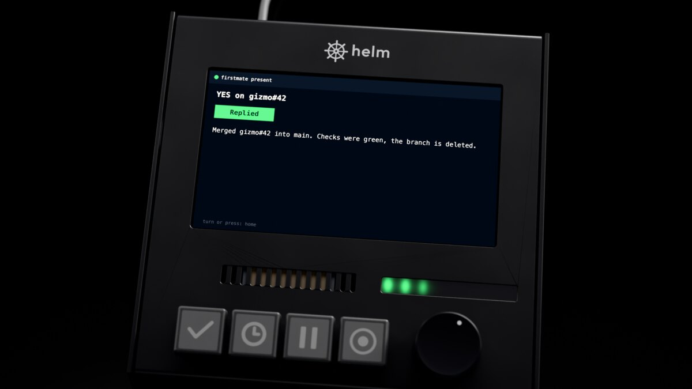<br><strong>Firstmate replies.</strong> Its answer shows on the deck, and the light bar sweeps green when the PR lands.</td>
  </tr>
</table>

**The light bar (8 lights)**

| What you see | What it means |
| --- | --- |
| Lights pulsing in color | One light per new item: red for a decision, blue for a PR ready, amber for a stuck worker or a herdr agent waiting. A paler shade means a different project. |
| A soft white gauge | Nothing new. The lit lights show what is left of your tighter Claude usage window, out of eight. |
| Gauge with the last light amber | A herdr agent is at 80 percent or more of its context window. |
| A green light sweeping left to right | Something just landed. |
| All lights amber | Helm cannot hear firstmate right now. |
| No gauge lights | Usage is unknown. Helm never shows a full gauge it cannot vouch for. |

**The chime:** one short tone when something new needs you, through the board's own speaker. Silent while firstmate is away. Mute it with a long press on the knob.

## What it shows

The screen is a 1280 x 720 touch screen. These are screenshots from the simulator, which draws the same layout as the firmware, with invented demo data.

<table>
  <tr>
    <td colspan="2">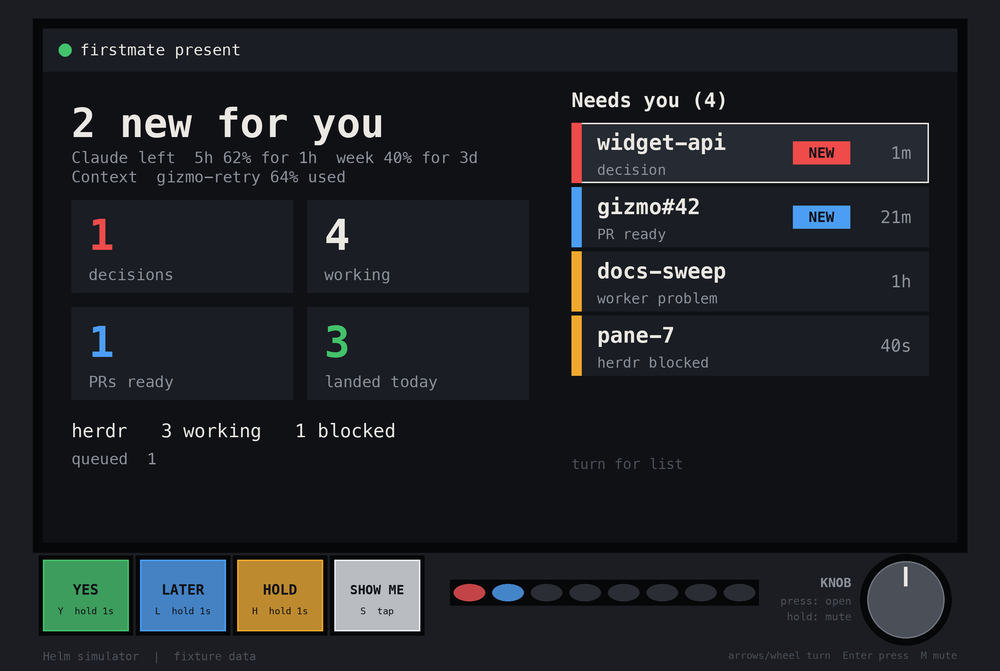<br><strong>Home.</strong> "2 new for you" or "All quiet", your Claude usage and the fullest agent's context, four tiles, a herdr line, and "Needs you" with up to five items.</td>
  </tr>
  <tr>
    <td width="50%">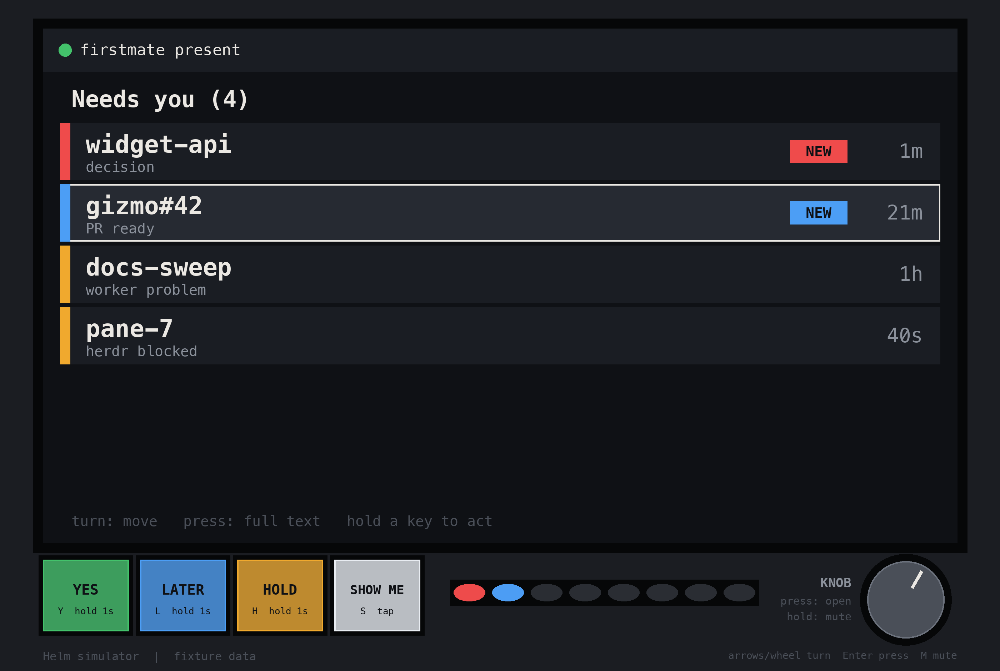<br><strong>List.</strong> Every item, color coded, with its kind, project, age, and NEW on the ones you have not seen.</td>
    <td width="50%">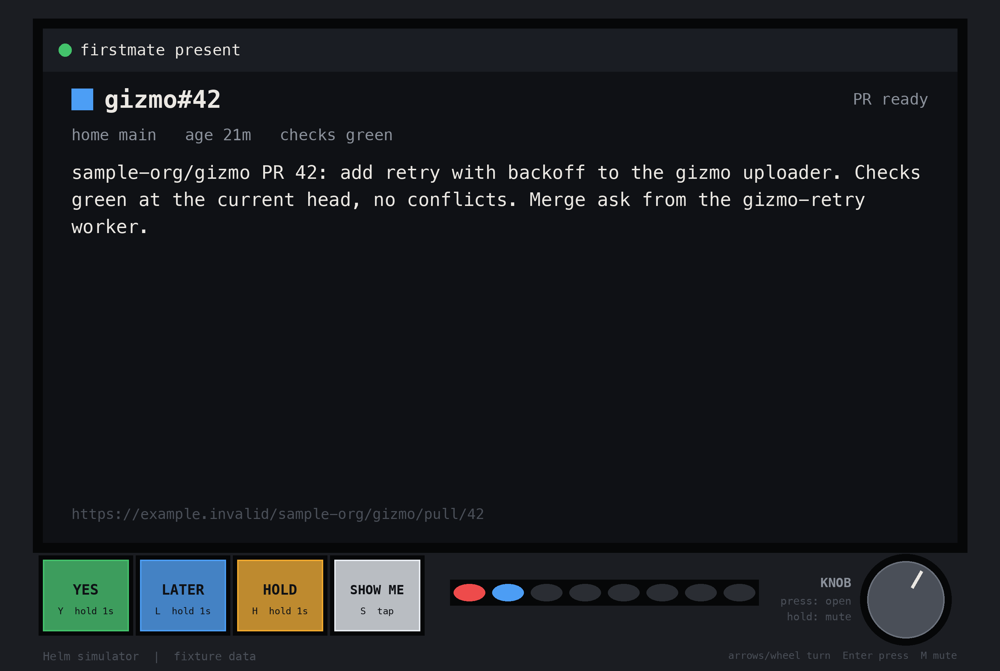<br><strong>Detail.</strong> The full text, only when you press the knob on an item.</td>
  </tr>
  <tr>
    <td>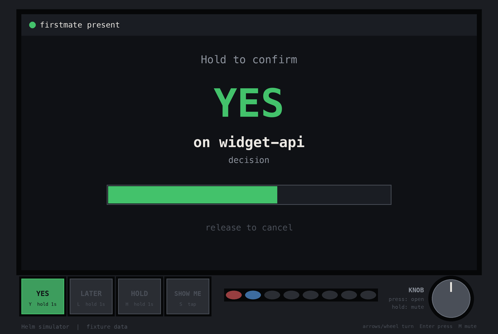<br><strong>Confirm.</strong> While you hold a key: the exact item and action, with a one second fill bar.</td>
    <td>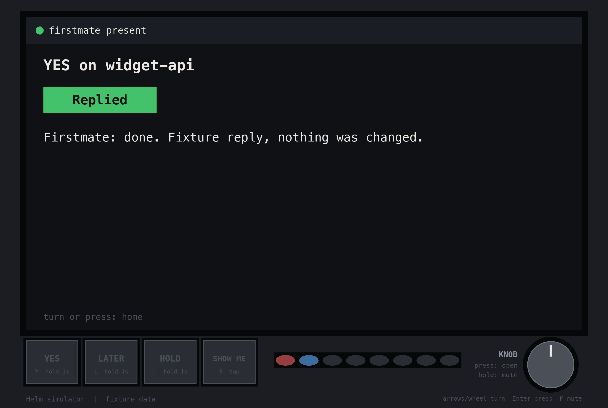<br><strong>Result.</strong> Queued, then firstmate's reply, or Failed with the reason.</td>
  </tr>
  <tr>
    <td>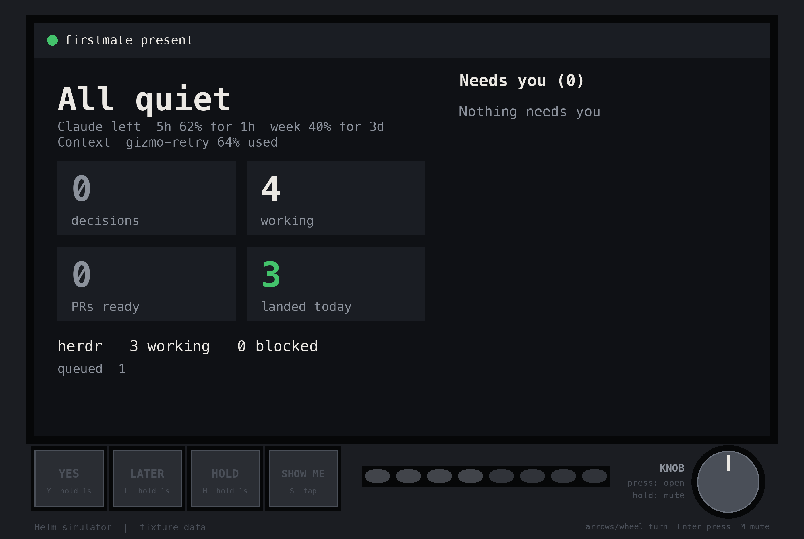<br><strong>All quiet.</strong> Nothing new: the light bar becomes the usage gauge.</td>
    <td>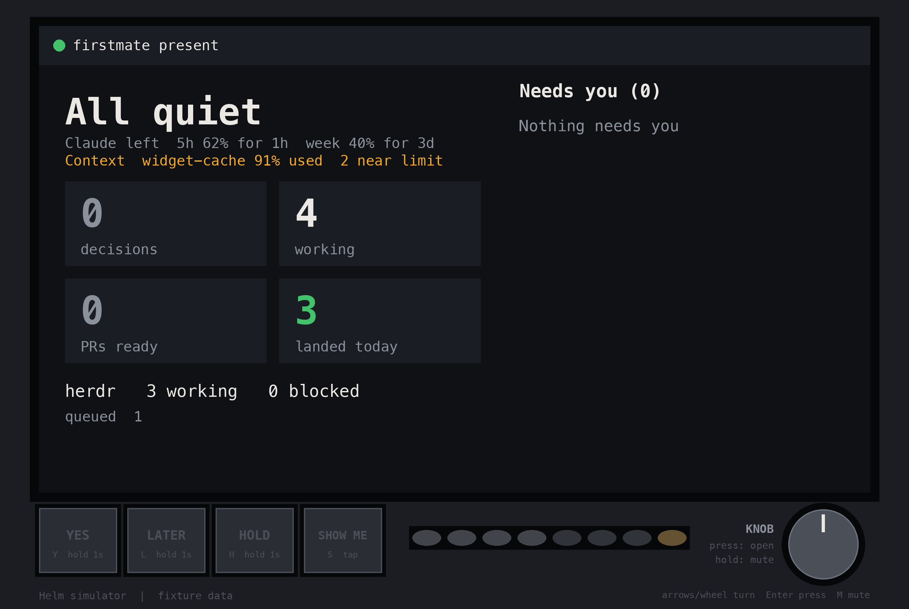<br><strong>Near the limit.</strong> An agent at 80 percent of its context turns the line and the last light amber.</td>
  </tr>
  <tr>
    <td>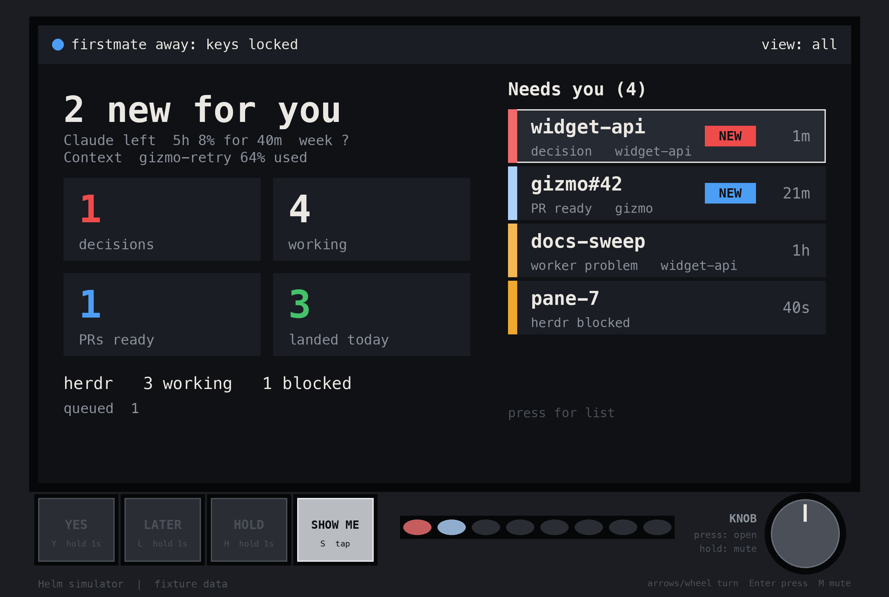<br><strong>Away.</strong> Firstmate away or quiet: YES, LATER, and HOLD lock, the chime stops, SHOW ME still works.</td>
    <td>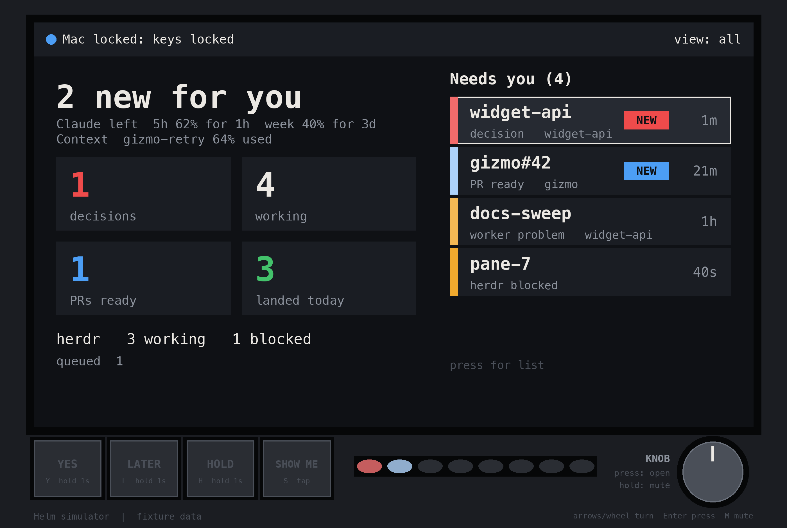<br><strong>Mac locked.</strong> Every key goes dark, checked again at the moment of a press.</td>
  </tr>
</table>

## Features

- **What needs you, not everything that is open.** The lights mean "new since you last looked". Everything already open when Helm starts counts as seen, and any touch of a key or the knob marks the rest seen. A new decision, a blocked or failed worker, a PR waiting on you, or a herdr agent waiting for approval lights the bar, rings the chime once, and goes to the top of the list.
- **One held key, one note.** YES, LATER, and HOLD each send firstmate one short note about the exact item on screen. Each note is keyed to the item, the answer, and the day, so pressing again is a replay, not a second note. Firstmate's reply shows on the deck.
- **Your word, behind firstmate's guards.** Firstmate treats a held YES as your word for exactly the one PR or decision it names, and nothing broader. It merges only through its own checks: the PR open, not a draft, mergeable, conflict free, and every check green at the exact current commit, read live at merge time. Helm itself cannot merge, push, or type into a pane.
- **A short leash on the Mac.** The bridge runs a fixed allowlist of commands and refuses everything else before a process starts. It starts in dry run, logging notes and opens instead of sending them, until you start it with `--live`.
- **Mac lock.** Lock your Mac and every key goes dark, SHOW ME too. The lock is read again right before acting on any press. The deck still lights up, so you see what waited for you.
- **Away mode.** Put firstmate in away or quiet mode and the answer keys lock and the chime goes silent. SHOW ME still works and the lights still show new items.
- **Usage and context gauges.** Home shows what is left of your Claude 5 hour and weekly windows and when each resets, plus the herdr agent closest to its context limit. Unknown readings show as unknown, never as full.
- **Every project, its own shade.** Turn the knob on Home to step through your projects. Each project gets a paler shade of the item's color on the lights and list, so red still reads as red and amber as amber.
- **Every home, one deck.** Helm reads your primary firstmate home and every second mate home it lists, and labels each item with the home it came from.
- **Works without the extras.** With no keys or knob fitted, four on-screen keys and swipe, tap, and long-press gestures do the same jobs, and only a held key ever acts.
- **Built like a tool.** A sloped case in black anodized 5052 aluminum, 145 mm wide, with a 15 degree face, hidden fasteners, and the helm wheel mark laser engraved on the face. MX switches under black keycaps with shine-through icons (any Cherry MX cap fits), a black aluminum knob, and one USB-C cable to your Mac from a jack in the back wall.

<table>
  <tr>
    <td width="50%">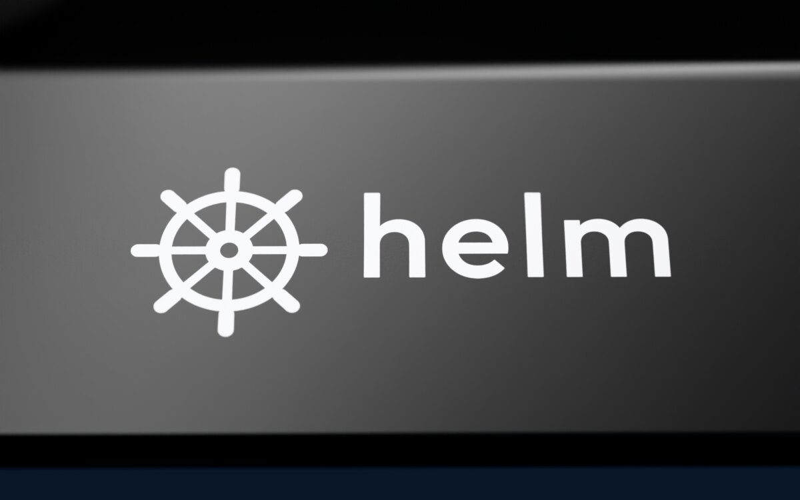</td>
    <td width="50%">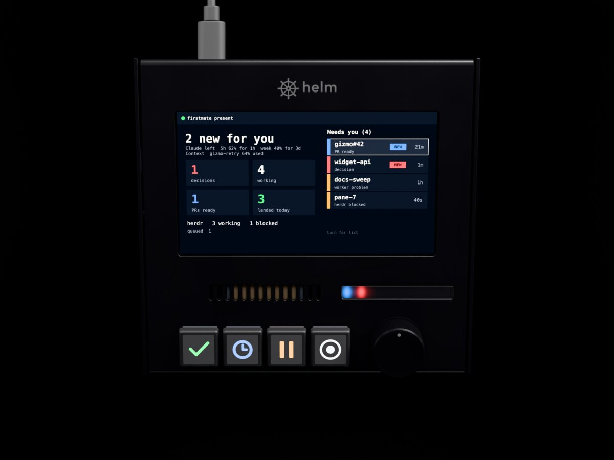</td>
  </tr>
</table>

## How it works

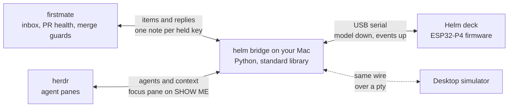

The deck stays thin: it draws the model the bridge sends and reports key and knob events. All the judgment lives in firstmate.

| Part | What it is | Docs |
| --- | --- | --- |
| Bridge (`helm/bridge/`) | The program on the Mac between the deck, firstmate, and herdr. Reads state, builds the item list, turns held keys into firstmate notes, runs only allowlisted commands. Python 3.11+, standard library only, with a launchd agent to start it at login. | [helm/bridge/README.md](helm/bridge/README.md) |
| Wire (`helm/wire/`) | The binary frame both sides speak over USB serial (`A5 48`, CRC-16), with compact JSON inside. | [sim/README.md](sim/README.md#the-wire) |
| Firmware core (`firmware/core/`) | The deck's logic in portable C11: the wire, the model, screens and selection, the 1 s hold, lights, knob, chime. No allocation, unit tested on the Mac and cross-tested against the Python code. | [firmware/README.md](firmware/README.md) |
| Firmware app (`firmware/idf/`) | ESP-IDF and LVGL app for the Waveshare ESP32-P4-WIFI6-Touch-LCD-5, turned landscape: display, touch, USB, keys, knob, lights, chime. | [firmware/idf/README.md](firmware/idf/README.md) |
| Simulator (`sim/`) | A window that looks and behaves like the deck and speaks the same wire, so the bridge cannot tell it from the hardware. | [sim/README.md](sim/README.md) |
| Case (`case/`) | Parametric CadQuery source for the sheet-metal case, with committed STEP, DXF, STL, and engraving files. | [case/README.md](case/README.md) |

## What you need

- A Mac. The bridge uses launchd to start at login and macOS's `ioreg` for the lock check.
- firstmate running your crew, and herdr for the agent panes and SHOW ME's focus.
- Optional: `quota-axi` for the Claude usage gauge (without it the gauge reads unknown), and `lavish-axi` for SHOW ME's review boards and reports.

## Build your own

The build guides are for v2: the 5 inch Waveshare LCD-5 in the sheet-metal case, the build the firmware on main targets.

- **[Bill of materials](docs/build/bom.md)** ([CSV](docs/build/bom.csv)): every part with vendor, price, and stock, and totals by phase. The priced parts come to $171.51 before the SendCutSend case order and the logo engraving (prices checked 2026-11-10).
- **[Wiring](docs/build/wiring.md)**: each part to the LCD-5's 40-pin header as the firmware's defaults name them, and what to check on the real board.
- **[Assembly](docs/build/assembly.md)**: phase 1 on the breadboard (flashing and the bridge included), phase 2 the printed parts and bench measurements, phase 3 the SendCutSend order and the logo engraving.
- **[The case](case/README.md)**: two bent parts in 0.063 inch black anodized 5052 aluminum plus four small printed parts inside, with the DXF, STEP, and STL files committed so nobody needs CadQuery to order, print, or engrave. Engraving instructions are in [case/out/engrave/README.md](case/out/engrave/README.md).
- **[The firmware](firmware/idf/README.md)**: building with ESP-IDF v5.5.6, flashing, the pins, and the list of what to verify on the board.

v1, the 4 inch board in the first case, is in git history at commit `b2f7670`.

## Try the simulator

No hardware needed. Python 3.11 or newer with Tk; no other packages.

```sh
# The simulator alone, with demo data
scripts/run-sim.sh --fake

# The simulator and a demo bridge, over the real wire
scripts/run-sim.sh --fake-bridge

# The simulator and the real bridge (dry run), connected through a pty
scripts/run-sim.sh --home /path/to/your/firstmate/home
```

In the simulator, hold Y, L, or H for YES, LATER, and HOLD, tap S for SHOW ME, use the arrow keys or scroll wheel to turn the knob, Enter to press it, and M to mute. The full key map is in [sim/README.md](sim/README.md#controls).

## Run it

```sh
# The bridge alone: one Model as JSON from the firstmate home, then exit
FM_HOME=~/path/to/firstmate python3 -m helm.bridge --once

# Tests
python3 -m unittest discover -s tests -t .

# The C device core (firmware/core): unit tests and cross-tests against helm/wire (needs cmake)
scripts/test-firmware.sh

# The deck firmware (firmware/idf): build for the Waveshare board (needs ESP-IDF v5.5.6, see firmware/idf/README.md)
idf.py -C firmware/idf build

# The case (case/): rebuild the DXF, STEP, STL, and renders (needs CadQuery, see case/README.md)
case/.venv/bin/python case/build.py

# The simulator screenshots in docs/sim/ (needs Pillow)
python3 -m sim.snapshot docs/sim
```

### Start the bridge at login

`scripts/install-agent.sh` installs a launchd user agent (`local.helm.bridge`) that runs `python3 -m helm.bridge --dry-run --port <device>` from this checkout, restarts it after a crash or a nonzero exit (every 10 s while the device is missing), and logs to `~/Library/Logs/helm/bridge.log`. Install from a checkout that stays put, since the agent runs the code in place.

```sh
scripts/install-agent.sh --port /dev/cu.usbmodem1101          # the real board (dry run)
scripts/install-agent.sh --port /dev/cu.usbmodem1101 --live   # send real notes, focus real panes, open boards and reports
scripts/uninstall-agent.sh                                    # stop it and remove the plist (--logs also deletes the logs)
```

The device path is the `--port` value. For the real board it is the USB serial device (`ls /dev/cu.usbmodem*`). For the simulator, run `python3 -m sim`, which prints `bridge port: /dev/ttysNNN`, and install with that path; the pty is new each time the simulator starts, so reinstall with the new path after restarting it. Do not run `scripts/run-sim.sh` while the agent is loaded: it starts its own bridge.

Dry run is always the default: rerunning the installer without `--live` switches a live agent back to dry run. Rerunning with the same options changes nothing; with new options it rewrites the plist and reloads the agent. Other options: `--home PATH` (firstmate home; default `$FM_HOME`), `--python PATH` (default: `python3` on your PATH at install time), `--no-launchctl` (write the plist without loading it). The installer touches only `~/Library/LaunchAgents/local.helm.bridge.plist` and `~/Library/Logs/helm/`. launchd does not rotate the log.

## Project status

- **Designed.** The v2 hardware (5 inch board, landscape, sheet-metal case) is designed; the case passes its SendCutSend rule, logo clearance, and interference checks in `case/build.py`.
- **Simulated.** The bridge and the simulator run end to end over the real wire. The test suite and the firmware core's C tests run in CI.
- **Firmware builds.** The ESP-IDF app builds in CI in its default configuration and with every alternative setting. Its screens were rendered on the Mac through the same LVGL and compared with the simulator.
- **Not yet done.** Nothing has run on a real board. Every pin, port, and timing assumption is listed under [Verify on the board](firmware/idf/README.md#verify-on-the-board). The product images are renders, not photos.

A finished Helm is planned for sale, for anyone who would rather not build one.

## Documentation

- Build: [bill of materials](docs/build/bom.md), [wiring](docs/build/wiring.md), [assembly](docs/build/assembly.md)
- Case: [case/README.md](case/README.md), [engraving](case/out/engrave/README.md)
- Firmware: [firmware/idf/README.md](firmware/idf/README.md) (the ESP-IDF app), [firmware/README.md](firmware/README.md) (the portable core)
- Bridge: [helm/bridge/README.md](helm/bridge/README.md)
- Simulator and wire: [sim/README.md](sim/README.md)
- Research and design decisions: [docs/research/README.md](docs/research/README.md)

## License

Software is licensed under the [Apache License 2.0](LICENSE). The case design (`case/`) and build guides (`docs/build/`) are licensed under [CERN-OHL-W-2.0](LICENSES/CERN-OHL-W-2.0.txt), and other documentation and images under [CC BY 4.0](LICENSES/CC-BY-4.0.txt). The Helm logo is not under an open license: [all rights reserved](LICENSES/LicenseRef-Helm-Logo.txt). Images and renders here that show the logo are licensed for their content, but that grants no right to use the logo itself. [`REUSE.toml`](REUSE.toml) maps every path to its license, and [`THIRD_PARTY_NOTICES.md`](THIRD_PARTY_NOTICES.md) lists third-party material.
