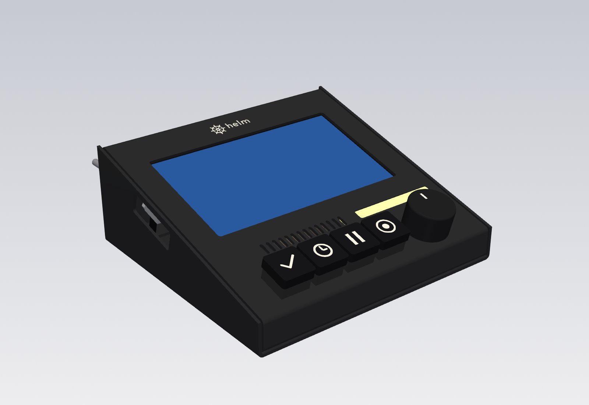
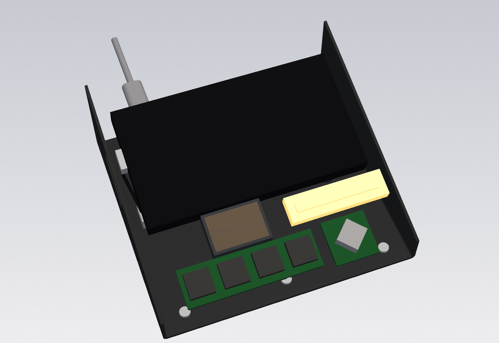
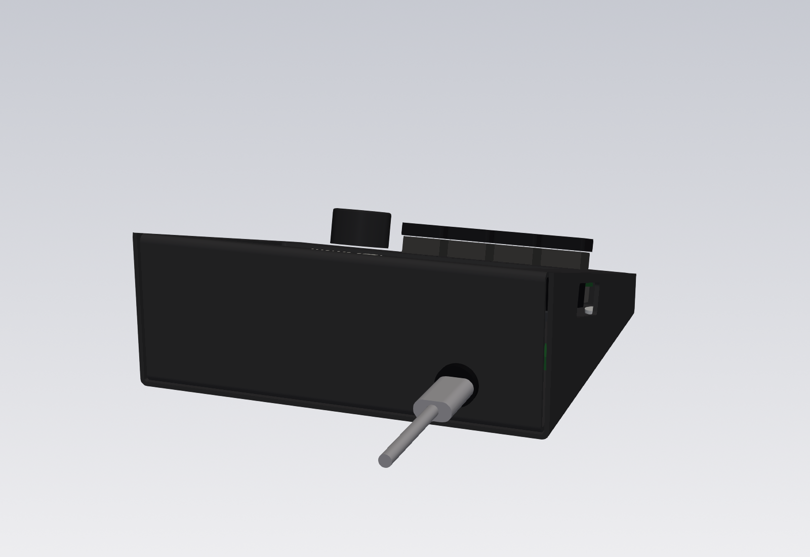

# Helm case

A sloped desk case sized to Helm's parts, as parametric source. One set of dimensions in [`helm_case/params.py`](helm_case/params.py) drives the **SendCutSend sheet-metal case**: two bent parts in 0.063 inch 5052 aluminum, black anodized (STEP models and DXF flat patterns), plus four small printed parts that go inside it (STL), and the files a laser shop needs to engrave the logo.



| Inside (cover removed) | Back: the everyday USB-C cable plugs in low |
| --- | --- |
|  |  |

Outside size: **145 wide x 135.7 deep x 54.4 tall** at the back (18.0 at the front), 0.71 litres. The face slopes 15 degrees.

The captain's answers this follows:

- **F2:** no stock box; a SendCutSend case sized to the parts. The [Hammond 1595E plan in case.md](../docs/research/case.md) is superseded.
- **Design v2 pick:** option C, the 5 inch board turned to landscape; flat black keycaps with lit icons; a machined black knob; hidden fasteners, screwed from the bottom; the wheel + "helm" logo (H1). Two notes came with it: machined aluminum caps should be an easy upgrade later ([Keys](#keys-and-caps)), and the logo needed more room above and below than the first render had ([Logo](#logo)).

The pick came out of a private design study that compared three case options with renders. The previous design (v1: the Waveshare 4B, a flat face plate screwed through the face, a printed test enclosure) is in git history at `b2f7670`.

## Why CadQuery

The source is Python with [CadQuery](https://cadquery.readthedocs.io/) 2.8, not OpenSCAD:

- **True arcs in the DXF.** CadQuery and ezdxf write real circles and arcs. OpenSCAD exports curves as short straight segments, which cut fine but make the hole sizes approximate in the file SendCutSend reads.
- **Sheet-metal flats are arithmetic.** Flat patterns come from SendCutSend's own bend radius (0.035 inch) and K-factor (0.42) with the standard bend-allowance formulas in [`sheet.py`](helm_case/sheet.py). The same code builds the bent solid with exact bend arcs, which exports as STEP, the format SendCutSend asks for on bent parts. OpenSCAD has no STEP export.
- **Checks run in the same language.** The rule checks and the parts interference check are plain Python tests, and Python is already the repo's language (the bridge and simulator).

The cost is a heavier install: CadQuery pulls in OpenCascade and VTK, about 1.3 GB in the virtual environment. The build was run and tested on Python 3.12.

## Build

```sh
uv venv --python 3.12 case/.venv
uv pip install --python case/.venv/bin/python -r case/requirements.txt
case/.venv/bin/python case/build.py          # writes case/out/, about 15 s
case/.venv/bin/python -m unittest discover -s case/tests
```

`build.py` exits non-zero if any SendCutSend rule check, the logo clearance check, or an interference check fails, and writes [`out/checks.txt`](out/checks.txt) with the measured minimums, the bend table, the logo's position, and the fit checks. Outputs are committed so nobody needs CadQuery to order, print, or engrave.

| File | What it is |
| --- | --- |
| `helm_case/params.py` | Every dimension, each marked VENDOR or ASSUMED |
| `helm_case/layout.py` | The face layout; the test coupon |
| `helm_case/sheet.py` | Bend math, the bent cover and base, flat patterns |
| `helm_case/printed.py` | The printed parts inside the case |
| `helm_case/assembly.py` | The case with stand-ins for the bought parts; interference check |
| `helm_case/checks.py` | SendCutSend rule checks on flat parts and DXF files; the logo clearance check |
| `helm_case/logo.py` | Places the logo on the face and writes the engraving files |
| `logo/` | The logo mark at 1:1 (SVG and DXF), the source the engraving files are made from |
| `out/dxf/` | SendCutSend cut files (flat patterns of the bent parts, the coupon) |
| `out/step/` | The bent parts as single solids, which is what SendCutSend takes for bent parts |
| `out/stl/` | Printable parts, already oriented for printing |
| `out/engrave/` | The logo for the laser shop: job file, placement drawing, [instructions](out/engrave/README.md) |
| `out/png/` | The renders above |

## Layout

Looking at the face, front edge toward you:

- **Keys** in a row at the front left: four MX holes, 14.00 mm square, on 19.05 mm pitch, centred at x = 25.5 to 82.7 mm, 15 mm up the face.
- **Knob** at the front right, beside the keys (x = 112).
- **Speaker slots** above the keys: 14 slots, 1.8 x 7.0 mm on a 3.6 mm pitch, over the 8 ohm 2 W speaker that comes with the board, in a printed gasket frame.
- **Light bar** beside the slots, above the knob: a 49 x 6 mm window. A printed white holder carries the NeoPixel stick and fills the window with a 1.6 mm diffuser, so the bar reads as a lit strip flush with the face.
- **Screen** behind them: the Waveshare ESP32-P4-WIFI6-Touch-LCD-5, turned so its native portrait panel reads as a 1280 x 720 landscape, with its USB-C short edge facing the left wall. The firmware's default screen rotation, 270, matches it. The face's 111.8 x 63.8 mm window frames the 110.32 x 62.28 mm viewing area and hides the glass's black border.
- **Logo** above the screen, centred on it, 5 mm from the window and 5 mm from the back bend.
- **Everyday USB-C cable** (power and the deck link): a panel jack **low in the back wall**, 15 mm above the desk, wired inside to the board's native USB port. See [the USB-C path](#the-usb-c-path).
- **Service slot** (`PORT_BAY_V`): a closed slot in the left wall, 33 mm long, over the module's USB-C edge. It exposes both receptacles, so the flashing cable plugs in without opening the case.
- **RESET, BOOT, and POWER** are on the module's long edge that faces the front, under the face and out of reach. Flashing does not need them: the CH343P resets the board into its bootloader through DTR and RTS (Waveshare's schematic). Whether the board powers on by itself when USB is plugged in is **not verified**; check it on the bench before closing the case ([wiring.md check 5](../docs/build/wiring.md#verify-on-the-real-board)).

The module rests face up on a printed **cradle**: a plate under its back, with a 1.6 mm foam pad between (about 1.5 mm compressed), on four legs that stand on the floor and take a heat-set insert each for an M3 screw up through the floor. With the cover on, the glass sits against the underside of the face and the foam takes up the tolerance. The cradle stops 1.5 mm short of the board's 40-pin header, a female socket on the module's back edge, so jumper plugs go into it from below; the fit check models the socket and its plugs. Nothing fastens to the face, so the face shows only the window, the keys, the knob, the slots, the light bar, and the logo.

## Keys and caps

The face is a standard MX plate: 14.00 mm holes (Cherry's +/- 0.05 mm for a 1.5 mm plate) on the standard 19.05 mm pitch, with Kailh switches on Adafruit NeoKey hot-swap sockets underneath. **Any keycap with a Cherry MX cross stem fits**, so the caps are a pull-off, press-on swap.

- **Chosen: black caps with shine-through icons**, lit by each NeoKey's light: Max Keyboard's custom backlight-compatible 1x1 caps ($10.00 each, 2026-11-10; the listing states Cherry MX compatibility), made from black-and-white icon art. They are OEM profile, taller and sculpted: no readable vendor sells *flat low-profile* MX caps with *custom* shine-through icons ([bom.md](../docs/build/bom.md#the-keycaps-custom-backlit-icons-now-aluminum-later)). The renders show 17.6 x 5 mm flat caps (`KEYCAP`); the fit check's aluminum envelope covers the taller caps too.
- **Upgrade: machined aluminum caps, no case change.** The fit check runs a second time with every cap replaced by an **18.6 mm square, 14 mm tall** envelope (`ALU_KEYCAP_MAX`), bigger than the aluminum MX caps listed below, and reports 0 overlaps (`out/checks.txt`). Two things change with solid metal caps: the icons cannot shine through (have them engraved instead), and the NeoKey lights show only as a glow around each cap's base. How heavier caps feel on the chosen switches is untested.

Machined aluminum 1u caps whose own listing states MX stem compatibility, checked 2026-11-10:

| Source | Price | Notes |
| --- | --- | --- |
| [Keychron aluminum alloy artisan keycap, AT-26](https://www.keychron.com/products/keychron-cute-computer-aluminum-alloy-artisan-keycap) | $24.99 per cap | "Compatibility: MX style switches"; CNC engraved; green and purple in stock, black sold out |
| [CNC machined 6063 aluminum keycaps, 1U, set of 4 (Amazon B0HFW9C7RY)](https://www.amazon.com/dp/B0HFW9C7RY) | $22.99 for 4 | "Compatible with Cherry MX style switches"; anodized silver; "only 7 left" |

## Knob

The encoder (Adafruit 5880, an EC11 with an M7 x 0.75 bushing) mounts through the face's 7.5 mm hole with its nut on top, and the board hangs from it. The knob is the **DROK 24 mm black aluminum knob** (24 mm flange, 19 mm body, 14.5 mm tall, set screw; [bom.md](../docs/build/bom.md#the-knob-drok-24-mm-aluminum-black)), the closest listed part to the design's machined knob with a skirt. No listing gives its recess depth, so whether it hides the nut is checked on the bench; another 6 mm set-screw knob drops in with no case change. The 5880's datasheet shows a 6 mm D-shaft standing about 7.5 mm above the bushing, but Adafruit's second drawing shows a knurled one: check the shaft on arrival.

## Logo

The wheel + "helm" mark (H1), 24.66 x 9.00 mm, is laser marked bright on the anodized face after SendCutSend has cut, bent, and anodized the cover; SendCutSend does not engrave. The mark sits above the screen window, centred on it, with **5.00 mm** to the window and **5.01 mm** to where the back bend starts: the captain's note on the first render was right, and the face grew 8.5 mm to make that room.

`checks.check_logo()` fails the build if the mark comes closer than 4 mm to any face cut, the cover's side edges, or a bend. Everything the laser shop needs, including the placement drawing and process settings, is in [`out/engrave/`](out/engrave/README.md). The mark's source is [`logo/`](logo/): drawn in code during the logo design work, with the word set in Outfit (SIL Open Font License 1.1) and turned to outlines.

## The USB-C path

```
Mac cable -> back-wall jack (Adafruit 6153) -> its lead, 4 wires soldered -> USB-C breakout (Adafruit 4090)
          -> slim right-angle ribbon (Adafruit 6370) -> the board's native USB port
```

- **Jack:** Adafruit 6153, a round USB-C panel jack on an M11 x 1 thread, in an 11.4 mm hole (`BACK_JACK_HOLE`; Adafruit gives 11 to 13.5 mm) at x = 30, 15 mm above the desk (`BACK_JACK_X`, `BACK_JACK_Z`), the lowest the sheet rules allow (6 mm from the bottom bend). The flange (13.8 mm, 3 mm thick) sits outside; the hex nut (14 mm, 3 mm thick) inside. Its CC pins are pulled down with 5.1 kOhm inside the jack, so a Mac powers it like any USB-C device, in either plug orientation. Its 175 mm lead carries VBUS (red), GND (black), D- (white), D+ (blue), CC1 and CC2 (green, yellow) to a 6-pin JST PH plug.
- **Breakout:** Adafruit 4090, 20.4 x 14.2 x 5.0 mm, on foam tape on the floor under the module, receptacle toward the left wall. Cut the JST plug off the jack's lead, feed the lead in through the hole from outside and fit the jack, then solder red to VBUS, black to GND, white to D-, blue to D+; insulate green and yellow and leave them unconnected (the jack already terminates CC).
- **Ribbon:** Adafruit 6370, 100 mm, a flat cable with slim right-angle USB-C plugs that Adafruit says carries power, data, and CC. In "USB" it drops straight down between the module and the left wall, clear of the other receptacle, and turns under the module to the breakout. The module sits 9 mm from the left wall's outside (`MODULE_X`) to make room for the plug head.

The LCD-5 keeps the 4B's pair of USB-C receptacles on one short edge, a CH343P USB-to-serial bridge on one and the ESP32-P4's native USB 2.0 high-speed port on the other, so the path is the same as before. On the LCD-5 they are labelled **"USB TO UART"** (the CH343P, nearer the button edge, so nearer the front as mounted) and **"USB"** (native, nearer the header edge, so nearer the back). Their centres sit on the PCB's rear face, about 9.3 mm behind the glass (`MODULE_USB_DEPTH`, scaled from Waveshare's drawing), which sets the service slot's depth. The ribbon goes into "USB"; the flashing cable plugs into "USB TO UART" through the slot.

## Printed parts

| STL | Qty | Orientation | Supports | Material |
| --- | --- | --- | --- | --- |
| `print_cradle.stl` | 1 | Module side down, as exported; the legs lean 15 degrees | None | PETG |
| `print_light_holder.stl` | 1 | Open side down, as exported; the diffuser bridges 10.6 mm | None | **White or natural** PETG (it is the diffuser) |
| `print_speaker_holder.stl` | 1 | Flat, as exported | None | PETG |
| `print_mx_coupon.stl` | 1 | Plate on the bed, rim up | None | PETG |

- 0.2 mm layers, 3 walls, 20 percent infill. PETG because the module and backlight run warm.
- The cradle's legs take an M3 heat-set insert each from below (holes 4.0 mm, `PRINT_INSERT_D`, 6.5 mm deep; match your inserts). A 1.6 mm adhesive foam pad goes on the cradle's top, under the module's back.
- The light holder and the speaker holder bond to the underside of the face (VHB tape or epoxy), since nothing on the face can hold them.
- Print the coupon first if you want an early check of the key and knob holes on your switches; the metal coupon below is the one that decides the hole sizes.

## SendCutSend sheet-metal case

Material for every part: **5052 H32 aluminum, 0.063 inch**, deburred, **black anodized**. All files are millimetres; set mm in the quote. Nothing has been uploaded or quoted.

| Part | File for the quote | Flat size (mm) | Bends | Hardware SendCutSend installs |
| --- | --- | --- | --- | --- |
| Cover (front flange, front wall, face, back wall with the USB-C jack hole, back flange) | `step/cover.step` (flat: `dxf/cover_flat.dxf`) | 139.60 x 231.61 | 90, 75, 105, 90 degrees | 6 x S-M3-0 nut, on the two bottom flanges |
| Base (bottom and both side walls; the left wall carries the service slot) | `step/base.step` (flat: `dxf/base_flat.dxf`) | 248.68 x 135.71 | 2 x 90 degrees | none |
| Test coupon | `dxf/mx_coupon.dxf` | 130.00 x 38.00 | none | none (order 1 only; deburred and black anodized like the rest) |

Both bent parts are constant-width strips with parallel bends, so no corner reliefs are needed. The cover sits between the base's side walls, 1.1 mm clear of each, and the side walls rise to the face's top surface. Six M3 x 6 screws come up through the base into the cover's flange nuts, and four more go up through the floor into the cradle's legs.

Bend table (centreline distance from the flat's first edge, from `out/checks.txt`):

| Part | Bend 1 | Bend 2 | Bend 3 | Bend 4 |
| --- | --- | --- | --- | --- |
| Cover | 90 degrees at y = 14.94 | 75 degrees at y = 29.19 | 105 degrees at y = 166.98 | 90 degrees at y = 216.67 |
| Base | 90 degrees at x = 53.10 | 90 degrees at x = 195.57 | | |

**The biggest open risk is the cover's fourth bend.** The rule checks treat each bend on its own; whether SendCutSend's press brake can form the last flange inside the U, and their tooling limits on a channel this shape, only show in their bend preview after an upload. If it is refused, the fallback is to drop the cover's two bottom flanges and put tabs with the nuts on the base's front and back edges instead.

### Rules the files are checked against

From [case.md](../docs/research/case.md#sendcutsend-design-rules) and SendCutSend's [hardware catalog](https://sendcutsend.com/guidelines/hardware/catalog/) (read 2026-11-09). `checks.py` tests each one on every flat part and `out/checks.txt` lists the measured minimums.

| Rule | Value | Smallest in the design |
| --- | --- | --- |
| Hole and slot size at least the thickness | 1.60 mm | 1.80 mm (speaker slots) |
| Hole to edge at least 2x thickness | 3.20 mm | 3.25 mm (the base's service slot) |
| Web between cuts (conservative, 1x thickness) | 1.60 mm | 1.80 mm (between speaker slots) |
| Features at least half the die width from a bend centreline | 5.99 mm | 6.20 mm |
| Hardware centre to edge or bend (S-M3-0: 0.250 inch) | 6.35 mm | passes on every nut |
| Minimum flange | 7.70 mm | 16.20 mm |
| Bend angle at most 130 degrees | 130 | 105 |
| S-M3-0 hole | 0.168 inch | as specified |
| Logo: engraving to any cut, side edge, or bend start (Helm's own rule) | 4.00 mm | 5.00 mm |
| DXF: mm units, one layer, closed cut paths only, no text | | checked on each file |

SendCutSend makes its own flat pattern from a STEP, so the flat DXFs of the bent parts are for reference and for checking a quote; their bend positions use SendCutSend's published radius and K-factor.

### Order plan

1. **Coupon first, deburred and black anodized** (the coating slightly shrinks the holes, so the fit matches the finished case): key holes 13.95, 14.00, 14.05, 14.10 (1 to 4 dots below each) and knob holes 7.2 and 7.5 (1 or 2 dots above). The 14 mm key hole needs +/- 0.05 mm and the laser holds +/- 0.127 mm, so this decides `KEY_HOLE` and `ENCODER_HOLE`.
2. On the bench, measure the assumptions below on the real board, switches, knob, and speaker, and print the four printed parts. Update `params.py` and rebuild.
3. Order the cover and base, black anodized with the six nuts. No extra coupon: the order 1 coupon is the laser shop's test piece. Check the cover's bend preview before paying (see the open risk above).
4. Have a local fiber laser shop mark the logo ([`out/engrave/`](out/engrave/README.md)), test piece first.

## Fit check

The interference check (`assembly.interference`) builds the whole case with stand-ins for every bought part and reports any two solids that overlap by more than 0.01 cubic mm. It covers the cover, base, cradle and foam, light and speaker holders, flange nuts, module, the module's 40-pin header and the jumper plugs in it, switches, NeoKeys and their wiring, caps, encoder and board, knob, speaker, light stick, back jack and nut, breakout, jack lead, ribbon and its plugs, and the flashing plug. It runs twice: with the chosen flat caps, and with the largest aluminum cap envelope. Both report 0 overlaps.

Four negative controls in `case/tests` prove it notices a fault: without the service slot the flashing plug hits the left wall; without its hole the jack hits the back wall; a cradle running under the header hits the jumper plugs; and with the logo at its first-round position the logo check fails.

## Parts and sources

| Part | Dimensions used | Source |
| --- | --- | --- |
| Waveshare ESP32-P4-WIFI6-Touch-LCD-5 | Glass 126.9 x 70.7 mm, 11.6 mm to the rear standoffs; viewing area 110.32 x 62.28 centred; PCB 118.5 x 64.5, 1.55 mm from the glass edge on the USB side; USB-C centres 23.26 mm from the header edge and 17.95 mm apart; 40-pin header pins 1 and 2 at 14.17 mm from the far PCB edge | [Waveshare dimension drawing](https://github.com/waveshareteam/ESP32-P4-WIFI6-Touch-LCD-5/raw/main/hardware/mechanical/ESP32-P4-WIFI6-Touch-LCD-5-dimensions-20260408.pdf), [wiki](https://docs.waveshare.com/ESP32-P4-WIFI6-Touch-LCD-5) size image, [schematic](https://github.com/waveshareteam/ESP32-P4-WIFI6-Touch-LCD-5/raw/main/hardware/schematic/ESP32-P4-WIFI6-Touch-LCD-5-Schematic.pdf) |
| Cherry MX switch | 14.00 mm hole, +/- 0.05; plate 1.5 +0.1 mm; plate top to PCB top 5.0 mm | [Cherry MX datasheet](https://www.farnell.com/datasheets/16916.pdf), via [case.md](../docs/research/case.md) |
| Adafruit NeoKey socket breakout (4978) | 0.75 x 0.85 inch PCB | [Adafruit product API](https://www.adafruit.com/api/product/4978) |
| Adafruit I2C encoder with encoder (5880) | 1.00 inch square board, encoder at the centre at 45 degrees; EC11 encoder, M7 x 0.75 bushing, 6 mm D-shaft | [Adafruit fab print](https://cdn-learn.adafruit.com/assets/assets/000/102/082/original/adafruit_products_REI2C_fab_print.png), [encoder datasheet](https://cdn-shop.adafruit.com/product-files/5880/P5880+-+EC11+drawing.pdf) |
| Encoder body (Bourns PEC11R style) | Mounting surface 5.5 to 6.5 mm above the PCB | [Bourns PEC11R datasheet](https://www.bourns.com/docs/product-datasheets/pec11r.pdf) |
| DROK aluminum knob, 6 mm | 24 mm flange, 19 mm body, 14.5 mm tall | [Amazon B0F21X91R4](https://www.amazon.com/dp/B0F21X91R4) |
| Speaker in the LCD-5 box, 8 ohm 2 W, GH1.25 | Size not published; sized as Waveshare's 2030 cavity speaker, 20 x 30 x 6.8 mm | [Waveshare LCD-5 store page](https://www.waveshare.com/esp32-p4-wifi6-touch-lcd-5.htm?sku=33762) (package contents), [Waveshare 27859](https://www.waveshare.com/8ohm-2w-speaker-b.htm) |
| NeoPixel Stick (1426) | 51.1 x 10.2 mm | [Adafruit 1426](https://www.adafruit.com/product/1426) |
| Adafruit 6153 USB-C panel jack to 6-pin JST PH | M11 x 1 thread 14.5 mm long, flange 13.8 x 3.0, hex nut 14 x 3.0, drill 11 to 13.5 mm, panel up to 7 mm, lead 175 mm; D+ and D- on both rows of the receptacle; CC pulled down with 5.1 kOhm | [Adafruit 6153](https://www.adafruit.com/product/6153) and its [datasheet image](https://cdn-shop.adafruit.com/product-files/6153/6153+datasheet.png) |
| Adafruit 4090 USB-C breakout, downstream | 20.4 x 14.2 x 5.0 mm; 5.1 kOhm on CC1 and CC2 | [Adafruit 4090](https://www.adafruit.com/product/4090) |
| Adafruit 6370 slim right-angle USB-C to USB-C cable, 100 mm | Plug head about 12 x 7.3 mm and ribbon about 5.8 mm wide, estimated from Adafruit's photo against a quarter; Adafruit verified power, data, and CC | [Adafruit 6370](https://www.adafruit.com/product/6370) |
| SendCutSend S-M3-0 nut | 0.168 inch hole, 0.059 inch proud; 0.250 inch to edge or bend, 5052 0.040 inch and up | [SendCutSend hardware catalog](https://sendcutsend.com/guidelines/hardware/catalog/) |

## Assumptions to measure before ordering metal

Everything here comes from a guess, a typical value, or a reading of a drawing that is not explicit. Each is a named value in `params.py`.

| Assumption (`params.py` name) | Value used | What to measure on the real part | What it moves |
| --- | --- | --- | --- |
| LCD-5 PCB centred on the glass (`MODULE_PCB_INSET_V`, `MODULE_USB_UART`, `MODULE_USB_NATIVE`) | USB-C at 26.4 and 44.3 mm from the module's front edge | Hold the module as mounted and measure each receptacle's centre from the glass edge | Service slot position, ribbon plug |
| USB-C depth behind the glass (`MODULE_USB_DEPTH`) | 9.3 mm (scaled from the drawing) | Glass face to the receptacle centre | Service slot depth |
| The 40-pin header (`HEADER_ROWS_IN`, `HEADER_HEIGHT`, `HEADER_PLUGS`) | Rows 3.1 and 5.6 mm in from the PCB edge, socket 5.1 mm proud of the PCB, 20 mm of plugs and wire bend below it | The socket, and your jumpers' housings | The cradle's back edge |
| The boxed speaker (`SPEAKER_BOX`) | 30 x 20 x 6.8 mm (Waveshare's own 2 W cavity speaker) | The speaker that comes with the board | Speaker holder |
| Screen window (`SCREEN_WINDOW_X`, `SCREEN_WINDOW_V`) | 111.8 x 63.8 mm | That the face frames the lit area with no border showing and does not press on the touch area | Face window |
| Cradle and foam (`CRADLE_T`, `CRADLE_FOAM`) | 3 mm plate, 1.5 mm foam compressed | That the module sits firmly against the face without bowing the glass, and does not slide | Cradle leg length |
| Encoder bushing on the 5880 (`ENCODER_HOLE`) | M7 x 0.75, hole 7.5 | Bushing thread and length, and whether it has an anti-rotation tab (add a hole if so) | Knob hole; coupon picks 7.2 or 7.5 |
| Encoder body (`ENCODER_BODY`, `ENCODER_BODY_HEIGHT`) | 13.4 x 12.5, 6.5 mm | Body size and plate-to-PCB height | Clearance |
| NeoKey stack below the plate (`KEY_STACK_DEPTH`, `NEOKEY_PCB_THICKNESS`) | 13.0 mm, 1.6 mm | Plate top to the lowest wire with a switch fitted | Front clearance |
| Keycaps (`KEYCAP`, `KEYCAP_HEIGHT`) | 17.6 mm, 5.0 mm | The chosen caps (the fit check also passes at 18.6 x 14 mm) | Spacing check, renders |
| Knob (`KNOB_D`, `KNOB_HEIGHT`) | 24 mm, 14.5 mm (DROK) | That its flange hides the encoder's nut | Spacing check, renders |
| Light bar LEDs (`LIGHT_WINDOW`, `LIGHT_STICK_THICKNESS`) | Window 49 x 6, stick 3.2 mm | LED span and stick height with LEDs | Light window, holder pocket |
| USB-C plug body (`USB_PLUG_OVERMOLD`) | 12.35 x 6.5 mm | Your flashing cable's plug body | Service slot size |
| Slim ribbon plug head (`RIBBON_PLUG_HEAD`) | 12 x 7.3 mm, 3.5 mm out of the receptacle | The 6370's plug head, especially how far it stands out of the port | Module distance from the left wall (`MODULE_X`) |
| Breakout receptacle height (`BREAKOUT_USB_HEIGHT`) | 4.2 mm above the board's underside | The 4090's receptacle centre | Ribbon plug clearance to the floor |
| Jack lead (`BACK_JACK_LEAD_D`) | 3.5 mm bundle | The 6153's six wires | Clearance only |
| S-M3-0 nut outside diameter | 6.0 mm | Not in the catalog | Clearance only |
| Heat-set insert hole (`PRINT_INSERT_D`) | 4.0 mm | Your inserts' recommended hole | Cradle legs |

## Not verified

- **No SendCutSend upload or quote**: price, and whether the bend preview accepts the four-bend cover (see the open risk above).
- The fit is checked against stand-ins built from the dimensions above, not real parts; nothing has been built or printed.
- **The module is located sideways only by the cradle's foam and pressure.** The face's window does not grip the glass, and there is no room for a locating rim on the left (the USB plugs) or the front (the speaker and light holders). If it shifts, add tabs on the cradle's right and back edges.
- The holders are bonded under the face; the bond's strength on anodized aluminum is untested.
- USB high speed through the 6153's unshielded lead and the 4090: the link runs at 480 Mbit/s over about 20 cm of hand-soldered wire and two extra connectors. Short runs like this usually work, but it is untested. Keep the lead short and twist the white and blue wires together.
- The 6370 ribbon is modelled as its plug heads and its straight drop beside the module; its turn to the breakout and the jack's lead are simplified.
- Wire routing inside the case is not modelled beyond the jumper plugs at the header (the wires to the parts, the LED and speaker leads). The boxed speaker's lead length is not published.
- **Whether the board powers on by itself from USB.** Its POWER button drives a power latch and is out of reach in the closed case.
- **No printed test enclosure.** The old one was built around face screws, and option C has none; the parts are fitted on the bench instead, and the anodized coupon checks the holes. A printed copy of the cover and base would be a separate design.
