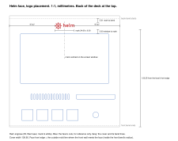

# Logo engraving: wheel + helm

Generated by `case/build.py` (`helm_case/logo.py`); edit the source, not this file.

The Helm deck's face carries one engraved mark: a ship's wheel beside the word "helm" (logo H1), **24.66 x 9.00 mm**, laser marked bright on the black anodized aluminum. SendCutSend cuts, bends and anodizes the cover, but does not engrave ("We do not offer laser engraving or solid etching at this time", their FAQ, read 2026-11-10; their single-line etch cannot be combined with anodizing). So a local shop with a fiber laser marks the finished, bent cover.

## Files

| File | What it is |
| --- | --- |
| `logo-h1-wheel-helm.dxf` | The mark at 1:1, mm (`$INSUNITS` 4), closed polylines on layer `ENGRAVE`, origin at its lower-left corner. **This is the job file.** |
| `logo-h1-wheel-helm.svg` | The same mark at 1:1: one black even-odd path, width and height in mm, with a 1 mm margin on each side. |
| `face_logo_placement.svg` | The face at 1:1 with the mark in place and dimensioned. Printed at 100 percent it doubles as a paper template. |
| `face_logo_placement.dxf` | The same face at 1:1: the cover's outline and bend lines (layer `FACE`), the face's cuts (layer `CUTS`) and the mark in place (layer `ENGRAVE`). Origin: the cover's left edge and the face's front edge. |

The filled area is what gets engraved: the wheel's gaps, its hub hole and the counters in the letters are inner contours, which laser software fills correctly with the even-odd rule (the usual default). The word is already outlines, so no font is needed. Curves are dense polylines (no splines), so any laser software reads them. Do not scale the mark: its thinnest line is 0.39 mm and narrowest gap 0.35 mm, and below 14.2 mm wide a feature would drop under 0.2 mm.

## Where it goes

The mark sits on the sloped face, above the screen window, reading left to right with its top toward the back of the deck:

| Position | mm |
| --- | --- |
| Centred left to right on the screen window (and on the 139.60 mm wide cover) | 0.00 offset |
| Screen window's back edge to the mark's bottom edge | **5.00** |
| Mark's top edge to where the back bend starts | 5.01 |
| Cover's left edge to the mark's left edge (and right edge to right edge) | 57.47 and 57.47 |
| Window's left edge to the mark's left edge | 43.57 |
| Face's front edge (outside mold line, inside the front bend's radius) to the mark's bottom edge | 123.25 |

Locate from the **screen window**: it is a sharp laser-cut edge on the same flat as the mark, so "centred on the window, 5.00 mm above its back edge" is the reference to jig from. The face's front edge is a virtual corner inside the bend radius, given only as a cross-check. `case/build.py` fails the build if the mark comes closer than 4.0 mm to any cut, the cover's side edges or a bend.

## The part

- **Material:** 5052 H32 aluminum, 0.063 inch (1.60 mm), black Type II anodized by SendCutSend.
- **Shape:** the cover is bent: the face is flat, with the front wall and back wall folded down from it. Resting on its bottom flanges the face slopes 15 degrees, so prop the front up 15 degrees (a wedge under the front flange, or a fixture that registers in the screen window) so the face sits square to the beam. Nothing stands above the face, so the lens has a clear path.
- **Cosmetic surface:** handle with gloves and protect the face from scratches in the fixture.

## Process

This is general practice for anodized aluminum, not a measured result on SendCutSend's anodize; a test mark comes first (below).

- **Fiber laser (1064 nm galvo marker, typically 20 to 50 W): the right tool.** It removes or bleaches the dyed anodic layer and leaves a crisp mark, usually white to light silver-grey and matte on black anodize. More energy ablates to bare aluminum, brighter and greyer. A MOPA fiber can tune the pulse for a whiter mark. Its 0.03 to 0.05 mm spot resolves the 0.35 mm gaps easily.
- **Settings to ask for:** a filled (hatched) engrave, not an outline: line spacing about 0.03 to 0.05 mm, cross-hatched at two angles for an even fill; optionally one outline pass for crisp edges; one or two passes, aiming for a uniform white or bright mark with no depth required (the anodize is only microns thick).
- **CO2 laser (10.6 um): second choice.** It cannot mark bare aluminum but can bleach dyed anodize white. Its larger spot (about 0.1 to 0.2 mm) can partly fill the 0.35 mm gaps inside the letters, so ask for a test first.
- **Diode lasers** can bleach anodize too, but slowly and with softer edges: fine for a trial, not the first pick.
- Expect a light satin mark rather than mirror chrome; judge it on the test piece.

## What to send the shop

1. `logo-h1-wheel-helm.dxf` (or `.svg`): "filled area is the engrave area, mm units, do not scale".
2. `face_logo_placement.svg` (print it at 100 percent) or the numbers above: centred on the window, 5.00 mm above its back edge.
3. The material, finish and fixturing notes above.
4. Process: fiber laser fill engrave, mark to white or bright metal, no depth.
5. **A test piece first:** add one `mx_coupon.dxf` coupon, black anodized, to the SendCutSend case order and have the shop run the mark and a couple of power settings on it before touching the cover.
6. Quantity, and ask them to keep the job file so later units match.

Trophy and award shops, sign shops and makerspaces often have a fiber marker. A mark this small is usually a minimum-charge job; no quotes were collected.

## Not verified

- No test mark has been made, so how the mark looks on SendCutSend's black anodize is unverified.
- The DXF was read back with ezdxf only, not opened in LightBurn or EzCAD (it is plain R2010 closed polylines, which they import).
