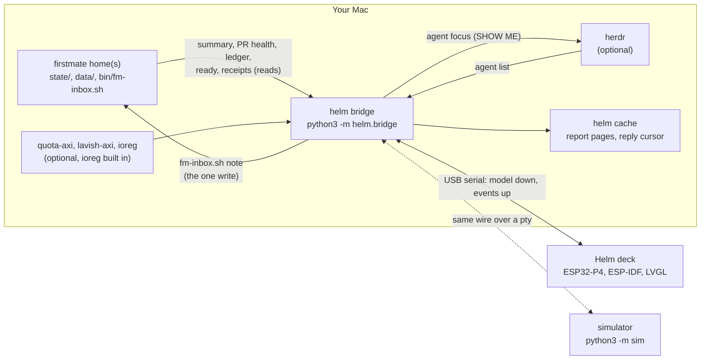

# Helm as built

This page describes the system on `main`: what each part does, what it reads from firstmate, and the one thing it writes. The research in [`docs/research/`](research/README.md) is the decision record of 2026-11-09, written before any of this existed; where the two differ, this page and the code win.

## The parts

| Part | Where | What it does |
| --- | --- | --- |
| Deck | `firmware/core/` (portable C11), `firmware/idf/` (ESP-IDF v5.5.6, LVGL 9.5) | The Waveshare ESP32-P4-WIFI6-Touch-LCD-5, turned landscape to 1280 x 720, with four MX keys, a push knob, an 8-light bar, and a chime. It draws the model the bridge sends and reports key and knob events. It knows nothing about firstmate or herdr. It links over the P4's native USB as a CDC-ACM device. Nothing has run on a real board yet: see [firmware/idf/README.md](../firmware/idf/README.md#verify-on-the-board). |
| Wire | `helm/wire/`, `helm/contract.py` | The Harness Pro binary frame, `A5 48 \| ver \| type \| len \| payload \| crc16` (CRC-16/CCITT-FALSE, payload at most 8192 bytes), carrying compact JSON with a `t` field. Down: the full `model`, every 2 s and on change. Up: `hello`, `key` (naming the item's `ref`), `knob`, `knob_press`, `select`, `seen`, `resync`. New fields are optional with defaults, so an older deck ignores what it does not know. |
| Bridge | `helm/bridge/` | Python 3.11+, standard library only, started at login by a launchd agent (`scripts/install-agent.sh`). Reads firstmate and herdr, builds the item list and the attention state, turns a held key into a firstmate note, and runs only an allowlist of commands. Dry run by default; `--live` sends notes, focuses panes, and opens pages. `--doctor` checks a home's setup, read only. Details: [helm/bridge/README.md](../helm/bridge/README.md). |
| Simulator | `sim/` | A Tk window with the deck's screen, keys, lights, and knob. It speaks the same wire over a pty, so the bridge cannot tell it from the hardware. Details: [sim/README.md](../sim/README.md). |
| Case | `case/` | Parametric CadQuery source for the black anodized 5052 aluminum case and its printed parts, with the DXF, STEP, and STL committed. Details: [case/README.md](../case/README.md). |

## What the bridge reads from firstmate

All in the primary home unless the row says each home. The homes are the primary plus every second mate home listed in its `data/secondmates.md`.

| Surface | Schema or format | Used for |
| --- | --- | --- |
| `state/home-summary.json`, each home | `fm-secondmate-home-summary.v1` | Items (decisions, PRs waiting on the captain, workers), counts, projects. Polled by mtime every 2 s. |
| `state/pr-health.json`, each home | `fm-pr-health.v1` | Keeping YES dark on a PR firstmate's monitor reported red or conflicted. Needs `config/pr-health-monitor`. |
| `state/fleet-ledger.jsonl`, each home | JSON Lines, `v: 1` ([firstmate's contract](https://github.com/kunchenguid/firstmate/blob/main/docs/fleet-ledger.md)) | Showing a new item the moment it happens. Needs `config/fleet-ledger`. New lines only. |
| `bin/fm-inbox.sh ready` | `fm-primary-ready.v1` | Whether firstmate can receive a note, and its posture (away mode). Every 15 s. |
| `bin/fm-inbox.sh receipts` | `fm-inbox-receipts.v1` | Firstmate's reply to a note, shown on the deck. Only while a note waits, once at start in `--live`, and on a replayed press. |
| `state/<id>.meta`, `state/<id>.status` | key=value; status lines | A task's herdr pane, project, and item age. |
| `data/<id>/report.md` and report paths in an item | Markdown or HTML | What SHOW ME opens when there is no live board. |

## The one thing it writes into firstmate

A held YES, LATER, or HOLD becomes exactly one `bin/fm-inbox.sh note --request-id <id> --json` in the primary home. If the note is saved but its wake fails (exit 3), the bridge repairs the wake with `bin/fm-inbox.sh announce` for that same note, never by sending again. Nothing else under any firstmate home is written: not a summary, not a status line, not a page.

What firstmate does with a note is firstmate's call. By default it reads a deck note as a message, not as the captain's approval. A held YES counts as the captain's word only in a home whose owner has added the rule in [docs/firstmate-setup.md](firstmate-setup.md), and even then firstmate merges only through `bin/fm-pr-merge.sh` and its own guards, pinned to the commit the deck showed.

Outside firstmate, the bridge writes only to its own cache (`~/Library/Caches/helm/` on macOS): rendered report pages for SHOW ME, and the receipts reply cursor.

## What it runs

The allowlist in `helm/bridge/commands.py` is the source of truth. Reads: `fm-inbox.sh ready` and `receipts`, `herdr agent list`, `quota-axi --provider claude --json`, `ioreg -n Root -d1 -a` (is the Mac locked), and `lavish-axi` alone (list boards). Writes, refused unless `--live`: `fm-inbox.sh note` and `announce`, `herdr agent focus`, `lavish-axi <page>` for a page in the helm cache or a home's `data/`, and `open <url>` for a loopback Lavish board or a GitHub PR. Anything else is refused before a process starts, which keeps the bridge away from every firstmate command that merges, sends, drains, or tears down.
