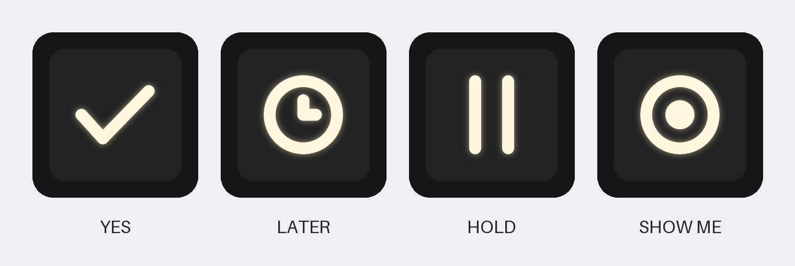

# Keycap icons

The art for Helm's four lit keycaps, ready to upload to [Max Keyboard's custom backlight compatible keycap](https://maxkeyboard.com/custom-backlight-compatible-keycap-for-backlit-keyboard.html) (the caps chosen in [bom.md](../bom.md#the-keycaps-custom-backlit-icons-now-aluminum-later)).



*A preview of how the icons read when lit, drawn from the art below. It is not the vendor's proof.*

| Key | Icon | Vector | Image |
| --- | --- | --- | --- |
| YES | Check mark | [yes.svg](yes.svg) | [yes.png](yes.png) |
| LATER | Clock, hands at twelve and three | [later.svg](later.svg) | [later.png](later.png) |
| HOLD | Pause bars | [hold.svg](hold.svg) | [hold.png](hold.png) |
| SHOW ME | Ring with a dot in the middle | [showme.svg](showme.svg) | [showme.png](showme.png) |

The icons match the renders (`_legend` in [`case/helm_case/assembly.py`](../../../case/helm_case/assembly.py)). SHOW ME is the ring with a centre dot the renders show; an earlier parts list called it an eye.

## What the vendor asks for, and how the art meets it

The listing's upload field, read 2026-11-10: "Image must be in Black and White. Black color will be the shine through area. File should be at least 300px resolution. Vector graphics preferred. (max file size 2mb. Allowed file: ai, eps, svg, jpg, gif, bmp, tif, tiff, psd, png, zip)". Its artwork guidelines image shows black art on white lighting up on a black cap.

- **Black is the icon**, on a white background. The SVGs carry an explicit white background so no tool reads a transparent background as black and lights the whole cap.
- **Vector first:** upload the `.svg`. The icons are filled outlines, not strokes, so nothing depends on the vendor's software keeping a line width. The `.png` files are the fallback: 1000 x 1000 px, 1-bit black and white, a few KB each.
- **One line weight, no hairlines:** every line is 9 percent of the canvas wide (about 1 mm if the icon is printed 7 to 8 mm across), and every dark gap inside an icon is wider than half a line, so the light stays even and the gaps stay dark.
- **Centred in the middle 60 percent** of a square canvas. The listing gives no canvas size, print area, or safe area, so this margin is an assumption; the comment below asks the vendor to centre and size it.

## Ordering

The listing takes one artwork upload per cart line, so the four icons are four lines of quantity 1:

1. Open the [listing](https://maxkeyboard.com/custom-backlight-compatible-keycap-for-backlit-keyboard.html).
2. **Keycap Size:** a 1x1 cap. The listing offers R1, R2, R3 and R4 1x1 (OEM rows, which differ in height and top angle); pick the **same row for all four** so the keys line up. R3, the home-row cap, is a reasonable default (a guess: the listing gives no heights). The case's fit check passes with any cap up to 18.6 mm square and 14 mm tall.
3. **Keycap Color:** Black (the other choice is Off-White).
4. **Secondary Print:** leave it at none. "Add Side Print" is an extra $5.00 and Helm does not use it.
5. **Upload Your Artwork:** the icon's `.svg`.
6. **Comments** (a suggestion): "Black is the shine-through area. Please centre the icon on the key top, about 8 mm across."
7. Add to cart, then repeat for the other three icons.

Price, 2026-11-10: $10.00 each, so $40.00 for the four, with quantity prices from 10 caps ($8.50 each). Spares are worth considering if a first cap shows the art needs changing.

## Changing the art

The icons are drawn in code by [make_keycaps.py](make_keycaps.py), which writes every file here. From the repository root:

```
uv run --with shapely==2.2.0 --with pillow python docs/build/keycaps/make_keycaps.py
```

Line width, canvas margin and the icon shapes are constants at the top of the script.

## Not verified

- How the vendor scales the art onto the cap: the listing states no print area, so the icon's printed size rests on the comment above.
- How evenly a NeoKey's light comes through the icons on these caps: check one cap before ordering a full set.
