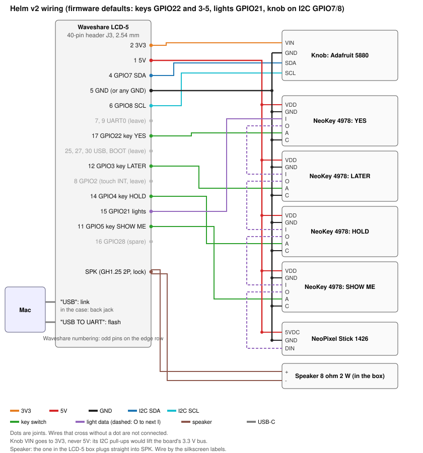

# Wiring: Helm v2

Every part on the deck that is not on the Waveshare ESP32-P4-WIFI6-Touch-LCD-5 board connects to the board's **40-pin expansion header J3** (2 x 20 pins, 2.54 mm pitch) or, for the speaker, to its **SPK** connector. The pins below are the firmware's defaults on main, so a stock build drives this wiring with no settings changed.

**Firmware state.** The firmware on main targets the LCD-5 ([`firmware/idf/README.md`](../../firmware/idf/README.md#pins)), and this page follows its pin defaults. It reads YES on **GPIO22** (header pin 17), not v1's GPIO2: on this board GPIO2 can carry the touch controller's interrupt (below). The firmware is the source of truth: if it moves a pin, re-check `firmware/idf/main/Kconfig.projbuild` and update this page to match. v1, the 4 inch board and its wiring, is at commit `b2f7670`.

## Where the pin numbers come from

- **GPIO numbers:** the defaults in [`firmware/idf/main/Kconfig.projbuild`](../../firmware/idf/main/Kconfig.projbuild): `HELM_PIN_KEY_YES` 22, `HELM_PIN_KEY_LATER` 3, `HELM_PIN_KEY_HOLD` 4, `HELM_PIN_KEY_FOCUS` (SHOW ME) 5, `HELM_PIN_LIGHTS` 21, `HELM_KNOB_I2C_ADDR` 0x36 on the shared I2C bus (GPIO7 SDA, GPIO8 SCL).
- **Header pins:** Waveshare's [LCD-5 wiki](https://docs.waveshare.com/ESP32-P4-WIFI6-Touch-LCD-5) pin table, the [schematic](https://github.com/waveshareteam/ESP32-P4-WIFI6-Touch-LCD-5/raw/main/hardware/schematic/ESP32-P4-WIFI6-Touch-LCD-5-Schematic.pdf) (J3, page 1), and the board's silkscreen (schematic page 2 and Waveshare's photos), all read 2026-11-10. All three agree.
- **SPK:** the wiki and store call it "GH 1.25 2PIN connector (with lock), supports 8Ω 2W speaker"; the schematic (J5, on the NS4150B amplifier's output) does not name the part.

**The header is numbered Waveshare's way, not the Raspberry Pi's.** Pin 1 is 5V and pin 2 is 3V3: odd pins on the row nearest the board's edge, even pins on the inner row, with pins 1 and 2 at the end away from the USB-C ports. The physical layout matches a Pi's, but every pair is swapped against Pi numbering. Waveshare's drawing also marks a square "pin 1" pad at the other end; that is the footprint's own numbering. **Wire by the silkscreen labels** (5V, 3V3, SDA, SCL, GND, and the GPIO numbers are printed beside the pins).

The header is a **female socket** (Waveshare says a Raspberry Pi HAT needs a male-to-male header to join it, and the photos show a socket body), so every wire into it needs a **male** end. Confirm on the bench ([check 4](#verify-on-the-real-board)).

## Wiring table

| Header pin | Signal | Goes to | Firmware setting (default) |
| --- | --- | --- | --- |
| 1 | 5V | All four NeoKey **VDD (+)**, NeoPixel Stick **5VDC** | |
| 2 | 3V3 | Knob (Adafruit 5880) **VIN** | |
| 4 | GPIO7, I2C SDA | Knob **SDA** | shared bus, knob at `HELM_KNOB_I2C_ADDR` (0x36) |
| 5 | GND | Knob **GND**, all four NeoKey **GND (-)** and **C** (switch cathode), Stick **GND** | |
| 6 | GPIO8, I2C SCL | Knob **SCL** | shared bus |
| 11 | GPIO5 | SHOW ME NeoKey **A** (switch anode) | `HELM_PIN_KEY_FOCUS` (5) |
| 12 | GPIO3 | LATER NeoKey **A** | `HELM_PIN_KEY_LATER` (3) |
| 14 | GPIO4 | HOLD NeoKey **A** | `HELM_PIN_KEY_HOLD` (4) |
| 15 | GPIO21 | YES NeoKey **I** (light data in), the start of the light chain | `HELM_PIN_LIGHTS` (21) |
| 17 | GPIO22 | YES NeoKey **A** (switch anode) | `HELM_PIN_KEY_YES` (22) |

Pins to leave alone:

| Header pin | Signal | Why |
| --- | --- | --- |
| 8 | GPIO2 | The schematic routes the GT911 touch interrupt to it through R108, marked "NC/0R"; whether R108 is fitted is not published, so the firmware leaves GPIO2 alone and a key here could read every touch as a press |
| 7, 9 | GPIO37, GPIO38 | UART0 to the CH343P: the flashing and log console |
| 25, 27 | USBD_N, USBD_P | The native USB data lines, wired in parallel with the "USB" receptacle; anything here becomes a stub on Helm's USB link |
| 30 | GPIO35 | The boot-mode strap (BOOT button and auto-reset); pulling it low at reset stops the board booting |
| 21, 23 | GPIO24, GPIO25 | The P4's full-speed USB PHY; usable as GPIO, but not needed |

Other spare pins, if the firmware ever needs one: GPIO28 (16), GPIO29 (20), GPIO30 (22), GPIO31 (24), GPIO32 (31), GPIO46 to 52 (35, 37, 39, 32, 34, 36, 38). The other 3V3 is pin 18, the other 5V pin 3, and GND is on pins 5, 10, 13, 19, 26, 29, 33, and 40.

The light chain, one data line through twelve lights in the order the firmware expects:

| From | To |
| --- | --- |
| Header pin 15 (GPIO21) | YES NeoKey **I** |
| YES **O** | LATER **I** |
| LATER **O** | HOLD **I** |
| HOLD **O** | SHOW ME **I** |
| SHOW ME **O** | NeoPixel Stick **DIN** |

The rest:

| Connector | Goes to | Notes |
| --- | --- | --- |
| SPK (GH1.25 2-pin, with lock) | The 8 ohm 2 W speaker that comes in the LCD-5's box | It plugs straight in. The Adafruit PicoBlade speakers and leads (3923, 3922) are a different 1.25 mm connector family and should not be expected to fit |
| "USB" (H2, the wiki's "USB OTG"; the receptacle nearer the header edge) | The Mac: the Helm link. In the case, through the back-wall jack ([below](#the-usb-c-link-in-the-case)) | ESP32-P4 native USB 2.0 high speed, CDC-ACM, `/dev/cu.usbmodem*` |
| "USB TO UART" (H1; the receptacle nearer the button edge) | The Mac: flashing and the log console | CH343P on UART0. Its DTR and RTS drive EN and GPIO35 through an EMH4T2R dual transistor (schematic), so esptool flashes without pressing BOOT |

Pad names (VIN, VDD, A, C, I, O, DIN, 5VDC) are the boards' silkscreen labels. Solder by label, not by position: the NeoKey has two 5-pin rows that carry the same signals except one, so check the silkscreen for which row has which.

**Wires.** On the bench, male-male jumpers (Adafruit 1957) go from the header's socket to the breadboard, where the parts sit on their own headers. In the case, female-male jumpers (Adafruit 1954) go from the header (male end) to header pins soldered on the parts and on a Perma-Proto board that splits 5V and GND (female end).

## The USB-C link in the case

In the case the Mac's cable plugs into a panel jack low in the back wall, not into the board ([case/README.md](../../case/README.md#the-usb-c-path)). Inside, the jack's lead goes to a USB-C breakout, and a slim right-angle ribbon goes from the breakout to the board's "USB" receptacle:

| Adafruit 6153 jack lead | Adafruit 4090 breakout pad | Signal |
| --- | --- | --- |
| Red | VBUS | 5 V from the Mac |
| Black | GND | Ground |
| White | D- | USB data |
| Blue | D+ | USB data |
| Green, yellow | Not connected (insulate) | CC1, CC2: already pulled down with 5.1 kOhm inside the jack, which is what tells the Mac to supply 5 V |

Then the Adafruit 6370 ribbon from the breakout's receptacle to "USB". Keep the soldered lead short (about 80 mm) and twist white and blue together: the link runs at USB high speed (480 Mbit/s), and this hand-wired stretch is the weakest part of it. "USB TO UART" stays free for flashing through the left wall's service slot, and both cables at once are fine: each receptacle feeds the board through its own ideal diode (schematic).

## Why it is wired this way

- **Keys:** the firmware reads each key pin with the internal pull-up on and treats low as pressed. On the NeoKey the switch and a 1N4148 diode sit in series between A and C, and Adafruit's instructions for a pull-up are: A to the microcontroller, C to ground. So a pressed key reads one diode drop above ground (about 0.6 to 0.7 V for a 1N4148), not 0 V. See the bench check below.
- **Lights:** one chain on one pin, so the four key lights and the eight-light bar share GPIO21. The firmware lights pixel 0 as YES, then LATER, HOLD, SHOW ME, then the stick "from the end nearest the keys", so mount the stick with its **DIN end toward the keys** (to the left, in the case).
- **Knob:** I2C, so it needs no pin of its own. It shares the bus with the board's GT911 touch (0x5D or 0x14), ES8311 codec (0x18), and ES7210 (0x40); the knob's 0x36 to 0x3D range clears all of them. The same bus also goes to the camera connector: **buy the LCD-5 without the camera (SKU 33762)**, since an OV5647 answers at 0x36 too (from the OV5647's datasheet, not a Waveshare page; not verified here).
- **Chime:** the board's own amplifier (NS4150B, enabled by GPIO53), so no pin.

## Power

Everything runs from the USB cable through the board's 5 V rail (plan D8: USB only).

| Rail | Feeds | Why |
| --- | --- | --- |
| 5V (pin 1) | NeoKey VDD x4, Stick 5VDC | The stick is specified for 5 V (4 to 7 V); the NeoKey lights take 3 to 5 V |
| 3V3 (pin 2) | Knob VIN | The encoder board runs on 3 to 5 V, and its I2C lines are pulled up to its VIN. On 5 V it would pull the board's 3.3 V I2C bus, shared with touch and both codecs, up to 5 V. **Never 5 V.** |
| GND (pin 5) | Every part | On the breadboard run it to the ground rail, in the case to the Perma-Proto's ground strip |

From the schematic: the header's 5V is the USB input after the ideal diodes, **before** the board's POWER switch, so it stays live whenever a cable is plugged in, even with the board switched off; the lights keep their power then. The header's 3V3 comes from a buck regulator (marked "3A MAX") after the switch and goes off with the board.

Budget: twelve lights at the firmware's brightness cap (`HELM_LIGHT_BRIGHTNESS` 64 of 255) draw at most about 12 x 60 mA x 64/255, about 180 mA. The board's own draw with the 5 inch backlight is not published; measure it first if you have a USB power meter, and keep the cap at 64 until you have.

## Verify on the real board

These are assumptions until a board is on the bench. Items marked **firmware** are also in the "Verify on the board" list in [`firmware/idf/README.md`](../../firmware/idf/README.md#verify-on-the-board); the rest come from this guide.

| # | Check | How | Source |
| --- | --- | --- | --- |
| 1 | "USB" is the receptacle nearer the header edge and "USB TO UART" the one nearer the buttons | Read the silkscreen beside each receptacle | this guide |
| 2 | "USB" enumerates as a CDC-ACM device and the bridge sees `device hello: fw=helm-idf-0.1 caps=screen-1280x720,...` | [assembly.md, step 1.4](assembly.md#14-point-the-bridge-at-the-board) | firmware |
| 3 | "USB" alone powers the board, and both cables at once cause no trouble | Plug each alone, then both | firmware |
| 4 | **Pin 1 of the header**, and that it is a female socket | Read the silkscreen ("5V 5V" at the end away from the USB ports). With the board unpowered, a meter's continuity setting should beep from any GND pin to a USB-C shell and stay silent from pin 1 | this guide |
| 5 | **The board powers on by itself when USB is plugged in** | Plug in "USB" and watch. The POWER button drives a power latch, and Waveshare does not say whether it starts on. In the case POWER is out of reach (on the module's front edge, under the face), so if it needs a press, stop and tell the case owner before closing | this guide |
| 6 | **Nothing is wired to header pin 8 (GPIO2)** | Look before closing: with R108 fitted (on the board's back, near TP2) the touch controller drives GPIO2, which is why YES is on GPIO22 | firmware |
| 7 | GPIO22 and GPIO3 to 5 read the key switches, pressed is low | With the keys wired, press each key and watch the deck act. GPIO3 to 5 default to JTAG pads (MTDI, MTMS, MTDO); the firmware takes them over | firmware |
| 8 | A pressed NeoKey reads low enough through its diode | Meter between the A pin and GND with the key held: expect about 0.6 to 0.7 V. If a press is missed, the low is too high for the input; tell the firmware owner before changing wiring | this guide |
| 9 | The knob answers at 0x36 on GPIO7/GPIO8 alongside the GT911, ES8311, and ES7210 | Boot log shows "seesaw hardware 0x87, product 4991", or "no knob at I2C 0x36" if it is not seen | firmware |
| 10 | Clockwise moves down the list, one step per detent; the push reads | Turn and press; set `HELM_KNOB_REVERSE` if it runs backwards | firmware |
| 11 | GPIO21 drives the chain in order: YES, LATER, HOLD, SHOW ME, then the stick from the end nearest the keys, with colors not swapped (GRB) | Watch the key lights against the screen's selection | firmware |
| 12 | 3.3 V data into lights powered from 5 V | WS2812B wants 3.5 V for a high at 5 V supply, so this is marginal. If the first light flickers or shows wrong colors: power the chain from 3V3 at the low brightness cap, or add a 74AHCT125 level shifter (Adafruit 1787, out of stock on 2026-11-09) | firmware |
| 13 | Colors read through the keycaps' icons, and the 64/255 cap is bright enough in daylight | Look | firmware |
| 14 | The boxed speaker plays the chime at a sensible level, and its size fits the case's speaker holder | Start at `HELM_CHIME_VOLUME` 30; measure the speaker against `SPEAKER_BOX` in `case/helm_case/params.py` (30 x 20 x 6.8 mm assumed) | firmware, this guide |
| 15 | In the case, "USB" enumerates through the back jack and the bridge sees `device hello`, with the Mac's cable plugged in either way up | Same as check 2, through the jack. If it fails there but works with a cable straight into "USB" through the service slot, suspect the soldered lead: shorten it, twist D+ and D-, and check the joints | this guide |
| 16 | The board's current draw with the 5 inch backlight | A USB power meter in the Mac's cable | this guide |
